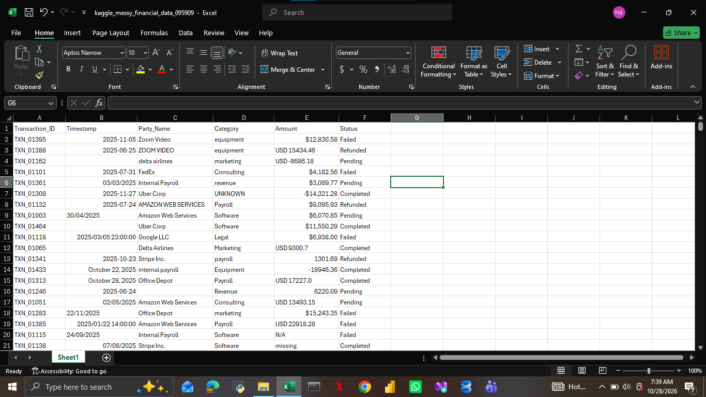

# FINANCIAL TRANSACTION ANALYSIS DASHBOARD
### End-to-End Data Analysis Using Microsoft Excel, Power BI & DAX

## 1. Project Overview

This project involves the analysis of financial transaction data to evaluate business financial performance, monitor revenue and expenses, understand transaction activities, and identify trends in financial operations.

The project was carried out using **Microsoft Excel for data cleaning and preparation** and **Microsoft Power BI for data analysis and visualization**. I also developed custom **DAX (Data Analysis Expressions) measures** to calculate financial KPIs, perform time-based comparisons, and generate dynamic insights.

The objective was to transform raw financial transaction data into an interactive dashboard that provides a clear overview of the organization's financial activities and supports data-driven decision-making.

The dashboard features five key performance indicators (KPIs), four major analytical visualizations, interactive slicers, navigation buttons, and Dark and Light Mode functionality.

## 2. Project Objectives

The primary objectives of this project were to:

- Analyze the overall financial performance of the business.
- Evaluate total revenue, total expenses, and net balance.
- Monitor the average value and total number of transactions.
- Identify the categories contributing the highest revenue.
- Analyze monthly transaction volume and identify trends.
- Examine the distribution of transaction statuses.
- Monitor the financial value associated with failed transactions.
- Compare financial performance across different reporting periods.
- Develop an interactive dashboard that simplifies financial reporting and analysis.

## 3. Tools and Technologies

| Tools | Application |
|---|---|
| Microsoft Excel | Data cleaning and preparation |
| Microsoft Power BI | Data modeling, analysis, and visualization |
| DAX | Creating calculated measures and financial KPIs |
| Power BI Slicers | Interactive filtering and exploration |
| Power BI Desktop | Dashboard development and design |

## 4. Data Preparation and Cleaning – Microsoft Excel

The first stage of the project involved preparing the raw financial transaction dataset using Microsoft Excel.

Data cleaning was necessary to improve data quality and ensure that the information was properly structured before analysis.

The preparation process focused on:

- Reviewing the dataset and understanding the available columns.
- Checking data consistency and identifying data-quality issues.
- Organizing and formatting columns appropriately.
- Preparing date and financial fields for analysis.
- Ensuring that the dataset was structured for effective analysis in Power BI.

After preparing the dataset, I imported it into Power BI for further analysis and visualization.

## 5. Data Analysis and DAX Measures – Power BI

After importing the cleaned dataset, I developed custom DAX measures to calculate important financial indicators.

These measures were used to generate dynamic KPIs and support comparisons across different periods.

### Key DAX Measures Developed

**1. Total Revenue**

Calculates the total revenue generated from financial transactions.

**2. Total Expenses**

Calculates the total expenses recorded within the selected reporting period.

**3. Net Balance**

Measures the financial balance remaining after deducting total expenses from total revenue.

**4. Total Transactions**

Calculates the total number of transactions recorded.

**5. Average Transaction**

Calculates the average financial value per transaction.

**6. Previous Year Comparison (YoY)**

Uses time-intelligence calculations, including `SAMEPERIODLASTYEAR()`, to compare current financial performance with the corresponding period in the previous year.

**7. Previous Month Comparison (MoM)**

Uses `PREVIOUSMONTH()` to evaluate changes in financial performance compared with the preceding month.

These calculations made it possible to evaluate financial performance beyond the current figures and understand how key metrics change over time.

## 6. Dashboard Design and Analysis

The dashboard was designed to provide a comprehensive overview of financial performance through five KPI cards and four major visualizations.

### A. Key Performance Indicators (KPIs)

The dashboard contains five major KPIs:

| KPI | Description |
|---|---|
| Average Transaction | Shows the average value of recorded transactions. |
| Net Balance | Displays the financial balance after expenses. |
| Total Expenses | Represents the total expenses recorded. |
| Total Revenue | Shows the total revenue generated. |
| Total Transactions | Displays the total number of transactions. |

**Financial Performance Snapshot**

The following figures were displayed in the dashboard:

| Financial Metric | Dashboard Value |
|---|---:|
| Average Transaction | ₦8,699.26 |
| Net Balance | ₦4,062,552.80 |
| Total Expenses | ₦843,927.12 |
| Total Revenue | ₦4,906,479.92 |
| Total Transactions | 525 |

These KPIs provide a quick understanding of the organization's financial position and transaction activities.

### B. Revenue by Category

**Visualization:** Horizontal Bar Chart

This visualization examines how revenue is distributed across different business categories.

The categories include:

- Revenue
- Equipment
- Travel
- Food
- Transport
- Marketing
- Operations
- Consulting
- Logistics
- Unknown

**Analytical Purpose:**

- Identify the highest revenue-generating categories.
- Compare the financial contributions of different categories.
- Identify categories with relatively lower revenue contributions.
- Understand the distribution of revenue across business operations.

This analysis helps identify areas that contribute significantly to the organization's revenue.

### C. Monthly Transaction Count Trend

**Visualization:** Line Chart

This chart illustrates the number of financial transactions recorded across different months.

It provides a monthly overview of transaction activities and helps identify fluctuations in transaction volume.

**Analytical Purpose:**

- Monitor transaction activities over time.
- Identify months with the highest transaction volumes.
- Detect periods of reduced transaction activities.
- Understand monthly transaction patterns.
- Support operational planning and financial forecasting.

The line chart makes it easier to identify changes in transaction activities throughout the reporting period.

### D. Transaction Status Analysis

**Visualization:** Pie Chart

This visualization examines the distribution of transactions according to their respective statuses.

The four transaction statuses analyzed include:

- Completed
- Refunded
- Pending
- Failed

**Analytical Purpose:**

- Determine the proportion of successful transactions.
- Monitor refunded transactions.
- Identify transactions that are still pending.
- Examine the percentage of failed transactions.
- Understand the overall distribution of transaction outcomes.

This analysis provides insight into transaction performance and helps identify areas that may require operational attention.

### E. Monthly Failed Amount Analysis

**Visualization:** Area/Line Chart

This visualization tracks the financial amount associated with failed transactions across different months.

It helps monitor the movement of unsuccessful transaction amounts and identify periods with relatively high failed transaction values.

**Analytical Purpose:**

- Track failed transaction amounts monthly.
- Identify periods with increased failed transaction values.
- Monitor fluctuations in unsuccessful transaction amounts.
- Support further investigation into transaction failures.
- Improve visibility into potential financial exposure.

## 7. Dashboard Interactivity and User Experience

To make the dashboard more interactive and user-friendly, I incorporated several Power BI features.

**Month Slicer:** Allows users to filter financial records by individual months.

**Category Slicer:** Enables users to examine financial performance across different categories.

**Status Slicer:** Allows users to analyze transactions based on their status.

**Clear All Slicers:** Provides an easy way to reset selected filters and return to the overall dashboard view.

**Dark and Light Mode:** Provides two visual themes, allowing users to switch between dark and light dashboard appearances.

**Navigation Buttons:** Allows users to navigate between the landing page and the financial overview page.

These interactive features make it possible to explore the financial data from different perspectives without changing the underlying dataset.

## 8. Key Financial Observations

Based on the figures and visualizations presented in the dashboard, the following observations can be made:

1. **Revenue Performance:** The dashboard recorded total revenue of ₦4,906,479.92, providing an overview of the financial value generated during the selected reporting period.

2. **Expense Management:** Total expenses stood at ₦843,927.12, allowing the business to monitor its recorded expenditure.

3. **Net Financial Position:** The business recorded a net balance of ₦4,062,552.80, representing the difference between total revenue and total expenses.

4. **Transaction Activities:** A total of 525 transactions were recorded, with an average transaction value of ₦8,699.26.

5. **Revenue Distribution:** Revenue by category provides visibility into the different business areas contributing to overall revenue.

6. **Transaction Performance:** The transaction status analysis provides a breakdown of completed, refunded, pending, and failed transactions, helping identify potential operational issues.

7. **Failed Transaction Monitoring:** The monthly failed amount visualization provides an opportunity to monitor unsuccessful transaction values and identify months that may require further investigation.

These observations demonstrate how financial data can be transformed into useful information for monitoring business performance.

## 9. Business Questions Addressed

The analysis was designed to answer the following questions:

1. What is the total revenue generated?
2. How much has the business spent?
3. What is the current net financial balance?
4. What is the average transaction value?
5. How many transactions have been recorded?
6. Which categories contribute the highest revenue?
7. How does transaction volume change monthly?
8. What percentage of transactions are completed, refunded, pending, or failed?
9. How much financial value is associated with failed transactions?
10. How does financial performance compare with previous months and previous years?

## 10. Skills Demonstrated

This project allowed me to demonstrate and strengthen my practical skills in:

- Data Cleaning and Preparation
- Microsoft Excel
- Microsoft Power BI
- Data Modeling
- Data Analysis
- DAX Measure Development
- KPI Development
- Financial Data Analysis
- Time Intelligence Functions
- Data Visualization
- Interactive Dashboard Development
- Business Intelligence
- Analytical Thinking
- Data Storytelling

## 11. Project Outcome

The project resulted in an interactive financial transaction analysis dashboard that converts raw financial records into meaningful financial insights.

By combining Excel, Power BI, and DAX, I developed a reporting solution that allows users to:

- Monitor financial performance through dynamic KPIs.
- Evaluate revenue and expense distribution.
- Track monthly transaction activities.
- Analyze transaction outcomes.
- Monitor failed transaction amounts.
- Compare financial performance across different reporting periods.
- Explore financial data using interactive filters.

The dashboard provides a centralized view of financial activities, making financial monitoring and analysis more accessible and efficient.

## 12. Conclusion

This project demonstrates my ability to apply data analytics tools to a financial business scenario, from preparing raw data in Excel to developing an interactive Power BI dashboard.

It also highlights my practical experience in creating DAX measures, developing financial KPIs, performing time-based comparisons, and presenting analytical findings through data visualizations.

Beyond building a dashboard, the project strengthened my ability to approach business data analytically, identify relevant performance indicators, and communicate findings in a clear and structured manner.

---

## Project Information

**Project Title:** Financial Transaction Analysis Dashboard

**Project Type:** Data Analytics / Financial Analysis

**Data Preparation:** Microsoft Excel

**Data Analysis and Visualization:** Microsoft Power BI

**Calculation Language:** DAX

**Dashboard Features:** Interactive Slicers, KPI Cards, Dark Mode, Light Mode, and Navigation Controls

**Author:** Rahman Azeezat Taiwo

**Area of Interest:** Data Analytics | Business Intelligence | Financial Analysis
